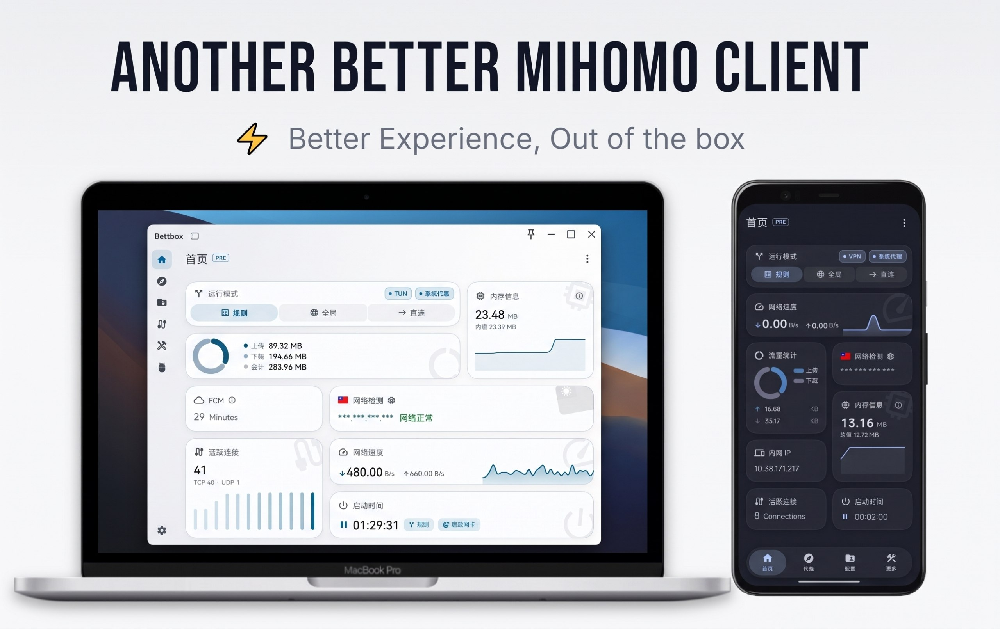

<h4 align="right">
  <strong>简体中文</strong> | <a href="readme/README_en.md">English</a> | <a href="readme/README_ru.md">Русский</a> | <a href="readme/README_fa.md">فارسی</a> | <a href="readme/README_ja.md">日本語</a> | <a href="readme/README_ko.md">한국어</a>
</h4>

<h1 align="center">⚡ Bettbox</h1>

## ⚠️ 使用前必读：个人自用、合法网络调试与责任声明

> [!CAUTION]
> **请在下载、编译、安装或使用前完整阅读本声明。**
>
> **用途与合规要求**：本项目仅供维护者本人在法律允许的范围内开展网络调试、故障排查、协议研究与个人测试。**禁止将本项目用于非法访问互联网、未经授权访问网络或信息系统、网络攻击、窃取数据、侵害他人权益以及其他违法活动。** 使用者必须自行确认所在地、所连接网络及具体使用场景的法律与管理要求，并对自己的操作及后果承担责任。若无法确认使用行为合法合规，请勿下载、部署或使用。
>
> **维护目的**：`KevinChen222/Bettbox` 的 `feat/smart-core` 是维护者为本人需求维护的个人分支。仓库和构建产物公开仅用于代码透明、学习交流与版本留存，**不构成面向公众的产品或服务，也不代表接受技术支持、故障处理、功能开发或持续维护的义务。**
>
> **无任何使用保证**：本分支及其构建产物按现状提供，未经面向公众的完整质量与安全认证。维护者不承诺稳定性、安全性、兼容性、可用性、适用性、数据完整性或更新时效；即使 Release 标为正式版，也不构成质量保证、安全认证、合规承诺或持续维护承诺。不得将其作为生产环境、关键业务或重要数据安全的保障。
>
> **自行评估并承担风险**：他人自行下载、编译、修改、分发或使用，应先备份配置与数据，并自行评估网络、设备及使用环境。由使用、更新或配置变更引起的连接中断、配置或数据损失、凭据泄露、隐私与安全风险、服务不可用及其他损失，须由使用者自行承担；违法使用产生的法律责任由实施者承担。**在适用法律及开源许可证允许的范围内，维护者不承担相关责任或赔偿义务。本声明不排除法律规定不得免除的责任。**
>
> **与上游独立，勿向上游追责**：本分支不是 Bettbox、FlClash、Mihomo/Smart 或 Avalon 的官方版本，本分支的修改与构建产物不代表获得其作者的审核、背书或支持。本分支新增功能、修改及构建产物产生的问题与上游作者无关。**请勿将本分支的问题、功能需求或 PR 提交到上游仓库或社群，也勿要求上游作者为本分支提供支持。** 本分支仅向 `KevinChen222/Bettbox` 提交和发布，上游仓库仅用于读取与合并更新。
>
> **上游介绍不等于本分支承诺**：下文保留的上游签名、审计、社区、赞助及其他介绍均属于上游项目。本分支产物不因此获得相同审核、签名、保证或官方身份。
>
> **开源许可保持有效**：本声明说明个人维护范围及使用风险，不修改原有开源许可证，也不额外限制许可证已经授予的使用、修改或再分发权利。

[Smart、落地节点、订阅合并与旧版升级](readme/Fork-Features.md)

---

<p align="center">
  <strong>Another Better Network Toolbox</strong>
</p>

**Bettbox 是基于 Mihomo 内核的多平台网络分流与 DNS 调试工具。更专注于极致的用户体验，为长期稳定运行而生，轻量省资源，且不收集任何数据。**

上游项目 Bettbox 取自 Better Network Toolbox。上游 Windows 版使用 SignPath 开源基金会提供的 OV 代码签名；本分支的下载入口见下文。

[](https://github.com/KevinChen222/Bettbox/releases/latest) [](https://github.com/vernesong/mihomo/tree/Alpha)

<p align="center">
  
</p>

---
### ✈️ Telegram 社区交流

[](https://t.me/bettbox_chat) [](https://t.me/appshub_channel)

---
## 🚀 核心特性

* **开箱即用**：权限引导、TUN 与托管分流模式均已预置，安装后即可使用。
* **轻量畅快**：移动端低功耗，桌面端后台占用低，界面动画流畅。
* **安全可信**：内核跟随 Mihomo 主线，各平台只申请最小权限。
* **稳定容错**：优化多平台极端网络环境下的边界问题，配置双重校验，适合长期运行。
* **架构优化**：桌面端原生支持 ARM64，持续维护面向旧设备的 Compatible 兼容版。
* **智能守护**：多平台智能启停，适配移动端 Doze 休眠，桌面端多平台托盘快捷控制。
* **可视化设置**：参数可视化调节，改动即时生效，小白用户无需手动改写配置。
* **首页小组件**：内置多款设计精良的 Widget 小组件，首页可掌控全局运行状态。
* **全能工具箱**：内置专业级别网络与 DNS 分流调试工具，网络状况一目了然。
* **节点与订阅管理**：从节点页为落地节点设置前置代理，或通过订阅合并统一管理多个配置。
* **个性化定制**：多套类 MD 色彩主题，可自定义图标，提供多种测速动效。
* **生态与扩展**：外置 JS 覆写脚本可适配图形界面，高性能 Code-forge 编辑器。
* **零隐私风险**：代码开源、无广告，CI/CD 全自动且公开可审计，无后台数据收集。
* **社区导向**：认真对待社区反馈，与活跃用户社群共同进化，积极响应高质量 Issue。

---
## 🛠️ 安装与下载

本 Smart 自用分支的 Windows x64 便携包、Android arm64-v8a 单架构 APK 和 Ubuntu 24.04 Linux x64 DEB 位于 **[[个人 fork Releases]](https://github.com/KevinChen222/Bettbox/releases)**。以下其他平台及安装方式沿用上游介绍，不表示本分支提供对应的 Smart 产物。

* **桌面端支持**:
  * **Windows 8.1+:** (x64 / arm64)
  * **Linux Kernel 5.4+:** (x64 / arm64)
  * **macOS 12.0+:** (Intel / Apple Silicon)
* **移动端及其他**:
  * **Android 7.0+（上游 Gradle 最低 API 24）:** (ARMv8 / ARMv7 / x86_64 / Universal)
  * **Android TV:** 完整大屏适配，可选 ARMv7 32位版本
  * **鸿蒙 NEXT:** 可配合 [[卓易通]](https://harmonyos.cool/android-app) 稳定使用

**Linux社区维护包:**<br>
* **ArchLinux:** <code>yay -S bettbox-bin</code> 或 <code>paru -S bettbox-bin</code> (由 [lyj404](https://github.com/lyj404/bettbox-aur) 维护)<br>
* **AMD64=v1 (兼容版):** <code>yay -S bettbox-compatible-bin</code> 或 <code>paru -S bettbox-compatible-bin</code> (由 [VillagerTom](https://github.com/VillagerTom) 维护)

---
## 💡 常见问题

1. **安装环境与兼容版本**：
   - 安卓端设备请检查后台运行权限。本分支仅提供 arm64-v8a；Android 7.x 在 Smart 产物上的兼容性需以对应构建的实际验证为准。
   - 桌面端老旧硬件请根据 CPU 指令集架构选择对应的上游 Compatible 版本。

2. **桌面端权限与 TUN**：
   - Windows 端管理员权限安装包已内置处理，日常使用无需手动再次授权。
   - macOS / Linux 开启 TUN 虚拟网卡时，请在系统提示时输入正确的系统密码以完成授权。
   - 如遇其他报错，请先确认后台没有其他代理工具冲突占用端口，并附带 Debug 日志提交反馈。

3. **macOS 首次安装指南**：
   - 根据平台 (Intel / Apple Silicon) 下载并打开 `.dmg` 安装包，将 Bettbox 图标拖入 Applications 文件夹。
   - **避开系统安全拦截**（[当前暂未购买 Apple 商业开发者证书](https://support.apple.com/en-us/102445)）：
     - **推荐**：在“访达 - 应用程序”中，**右键点击 Bettbox 图标选择“打开”**，在系统弹窗中确认点击“打开”即可。
     - **备选**：若被阻止，可前往系统“设置 -> 隐私与安全性”，找到 Bettbox 点击“仍要打开”。
   - 首次开启 TUN 模式时，系统会提示密码授权，请输入密码允许创建虚拟网络接口。

4. **订阅导入与排障**：
   - 若导入失败，请优先在服务商后台重置订阅链接后重新尝试。
   - 如持续异常，请先向节点服务商核对节点格式，确认属客户端问题可随时提交 Issue。

---

## Smart 内核版本

`feat/smart-core` 分支跟随 Bettbox 上游主线，当前聚焦维护 vernesong/mihomo 的 **Smart 策略组**、**连接关闭高 CPU / 内存与资源泄漏稳定性维护**（见 [修复记录](readme/Smart-CPU-Fix.md)），以及覆盖个人仓库测试版与正式版的应用内更新检查，支持 Windows x64、Android arm64-v8a 和 Ubuntu 24.04 Linux x64。节点库、落地代理（链式代理）与订阅合并已由 Bettbox 上游原生提供。配置方法、内核来源和构建产物见 [Smart 使用说明](readme/Smart.md)。

更新与发布流程见 [维护说明](readme/AI_UPDATE_GUIDE.md)，本次版本变化见 [更新日志](readme/Smart-Release-Notes.md)。

##  开发构建及UI适配

以 Windows 平台构建为例：

* 系统需求：Windows 10 及以上
* 依赖环境：Git、Visual Studio、Flutter 3.50.1（上游 CI）、Dart 3.14+、Go、Inno Setup、Rust
```bash
* flutter pub get (获取相关依赖)
* dart .\setup.dart windows --arch amd64 --out core (仅构建Core核心)
* dart .\setup.dart windows --arch amd64 --out app --compatible (可选兼容版本)
* 构建完成后，最终产物位于 `dist/` 目录
```

自定义脚本 UI 适配：

* Bettbox 支持外置覆写脚本适配图形化 UI。以 AIsouler 的 **[脚本/配置分享](https://github.com/AIsouler/MyClash)** 为例，只需在脚本首行添加以下声明，即可直接联动内置可视化开关：
* <code>const Compatible_With_Bettbox = { ruleOptionsEnable: true };</code>
* 若脚本开关中包含策略组与其他功能开关，可通过 `policyGroupOptions` 声明策略组开关名称；未声明的开关会自动归纳至「⚙️ 其他设置」二级菜单：

```js
const Compatible_With_Bettbox = {
  ruleOptionsEnable: true,
  // 声明属于策略组的开关名称，需与 ruleOptionsEnable 的键完全一致
  policyGroupOptions: ['🚀 节点选择', '🛑 广告拦截'],
};
```
* 未声明 `policyGroupOptions` 或名称不匹配时，所有开关将平铺展示。

---
### 🛩️ 推荐服务

<table>
<tbody>
<tr>
<td width="180"><a href="https://api.muteki.site/register?aff=BETTBOX"></a></td>
<td><a href="https://api.muteki.site/register?aff=BETTBOX">MaruCode</a> 是一家偶尔做做慈善的小破站 API，自营号池，不搞充值营销套路，主要提供 Codex、Claude Code、GPT Image-2 等主流模型，支持 WebSocket 协议，明码标价(Codex 0.3x, CC 1.7x)，透明汇率(1:1)，<a href="https://api.muteki.site/register?aff=BETTBOX">新用户注册</a></td>
</tr>
</tbody>
</table>

--------------------------------
#### IEPL 专线  〢  [百变小樱](https://www.bbxy01.com/v2/register?code=c09R)  〢  [白月光](https://www.sibker.com/register?invite_code=YZq6L5zd)  〢  [Ytoo](https://y-too.net/aff.php?aff=10354)
--------------------------------
#### 低价 直连  〢  [良心云](https://xn--9kqz23b19z.com/#/register?code=VTnrQYAj)  〢  [吹雪云](https://xn--9kqs1lo79d.com/#/register?code=skKMTab7)  〢  [一分](https://xn--4gqx1hgtfdmt.com/#/register?code=AuCiXprV)
--------------------------------
#### 百变小樱专享68折优惠码：bettbox68 ，参见：[相关介绍](https://t.me/appshub_channel/381)

**简评** : ❚ ❚ 以上链接基本为自用或 TG 群组讨论推荐，此处仅做 AFF 展示（注：通过链接购买第三方服务，开发者可获得少量佣金支持），这并不代表对其服务作出承诺或保证。请自行甄别并合理选择。

---
### ☕ 赞助支持

**如果您觉得这个项目对您有所帮助，也可通过以下方式赞助开发或使用 [推荐链接](https://github.com/appshubcc/Bettbox#%EF%B8%8F-%E6%8E%A8%E8%8D%90%E6%9C%8D%E5%8A%A1)：**

* TRON (TRC-20)： <code>TCkTtZfF2WrciZLaJj3e1aqrh3zdTnCkDa</code>
* Bitcoin： <code>bc1qu950cl6035qvllmzk6cfw3l30j2lg3cq9n6g6h</code>

---
## ❤️ 致谢

<table>
  <tr>
    <td>
      
    </td>
    <td>
    Free code signing on Windows provided by <a href="https://signpath.io">SignPath.io</a>, certificate by <a href="https://signpath.org/">SignPath Foundation</a>
    </td>
  </tr>
</table>

* **[FlClash GUI](https://github.com/chen08209/FlClash)**（本项目起源于优秀的开源项目 FlClash，向原作者的开创性探索与贡献致敬）
* **[Mihomo Core](https://github.com/MetaCubeX/mihomo)**（强大灵活的核心驱动）

感谢所有为本项目添砖加瓦的 [Contributors](https://github.com/appshubcc/Bettbox/graphs/contributors)，以及以下开源项目的启发与使用参考：

[Zashboard](https://github.com/Zephyruso/zashboard), [CMFA](https://github.com/MetaCubeX/ClashMetaForAndroid), [Sparkle](https://github.com/xishang0128/sparkle), [SFA](https://github.com/SagerNet/sing-box-for-android), [HUSI](https://github.com/xchacha20-poly1305/husi), [V2rayN](https://github.com/2dust/v2rayN), [Bett-rules](https://github.com/appshubcc/bett-rules)

---
## 📈 项目热度

<p align="center">
  <a href="https://www.star-history.com/?repos=appshubcc%2FBettbox&type=timeline&legend=top-left">
    <picture>
      <source media="(prefers-color-scheme: dark)" srcset="https://api.star-history.com/chart?repos=appshubcc/Bettbox&type=date&theme=dark&legend=top-left" />
      <source media="(prefers-color-scheme: light)" srcset="https://api.star-history.com/chart?repos=appshubcc/Bettbox&type=date&legend=top-left" />
      
    </picture>
  </a>
</p>

---
## 📄 开源协议

本项目采用 [GPL-3.0 License](LICENSE) 开源协议。旧版贡献及其许可记录见 [NOTICE](NOTICE)。
